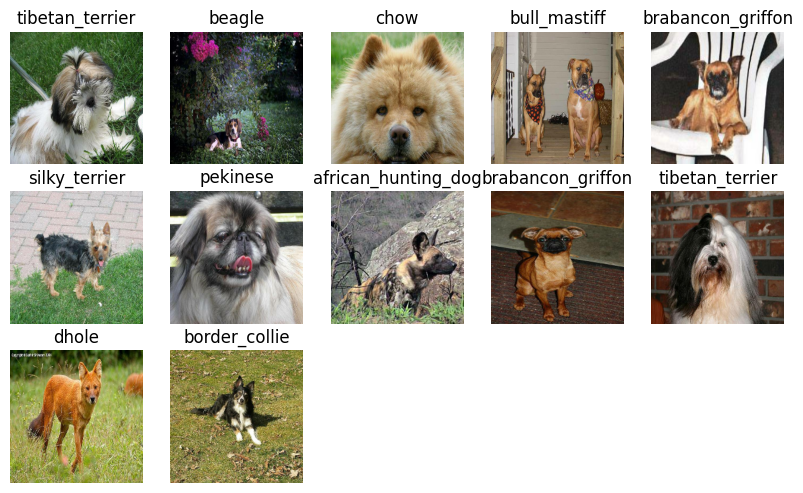
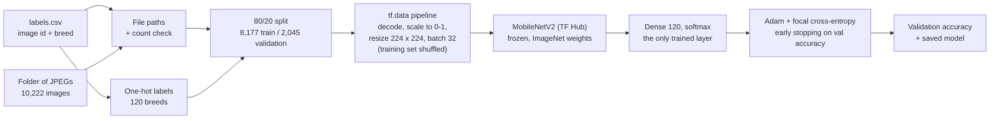

# Dog Breed Classifier

An image classifier that names a dog's breed from a photo, out of 120 breeds, using transfer learning on a frozen MobileNetV2.

*The first 12 images of a shuffled training batch with their labels, after preprocessing to 224 x 224. Photos from the public Kaggle "Dog Breed Identification" dataset.*

## The problem, and the key design decision

**Problem.** Tell 120 dog breeds apart from a single photo. Many breeds look alike, and there are only about 85 labelled photos per breed (10,222 images for 120 breeds).

**Key design decision: keep the pre-trained base frozen.** The model reuses MobileNetV2, pre-trained on ImageNet, with its 5.4 million weights left as they are, and trains only one new 120-way softmax layer on top (120,240 weights, about 2% of the model). I tested the alternative: making the whole base trainable cut validation accuracy from about 77% to about 45%. With so few photos per breed, retraining the base overwrote what it had already learned, so the final run froze it again.

## Architecture

More diagrams exported from the portfolio page: [model](docs/model.svg), [data pipeline](docs/data-pipeline.svg), [training workflow](docs/training-workflow.svg), and the run-6 [accuracy](docs/accuracy-chart.svg) and [loss](docs/loss-chart.svg) charts.

## How it works

1. **Labels and file paths.** The labels CSV holds an image id and a breed name per photo. The notebook builds one file path per id, checks that the count matches the image folder, and turns each breed into a one-hot row of 120. These steps are in the notebook, [`DogsCode.ipynb`](DogsCode.ipynb).
2. **Input pipeline.** 20% of the images are held back for validation. A `tf.data` pipeline reads, decodes, scales and resizes each image as it is needed and groups them into batches of 32. Only the training set is shuffled.
3. **Model.** MobileNetV2 (width 1.3, 224-pixel input) from TensorFlow Hub, loaded with `trainable=False`, plus one 120-way softmax layer.
4. **Training and experiments.** Adam, categorical focal cross-entropy, TensorBoard logging and early stopping on validation accuracy with a patience of 5. I compared six runs, changing one thing at a time: augmentation, fine-tuning the base, an extra dense layer, and finally freezing the base again.

## Security model

- **Public data only.** The dataset is the public Kaggle competition set; its labels hold only an image id and a breed name.
- **No personal data.** The images are of dogs. The model takes no names, locations or account data, and has nothing to store about people.
- **Data and models stay out of the repository.** The dataset and the trained model files are kept in cloud storage, not in the code repository.
- **Known processing location.** Training ran in a hosted notebook, so the data was processed in the cloud, not on my PC.

## Testing and results

| Run | Data | Change | Train acc. | Val acc. |
|---|---|---|---|---|
| 1 | 5,000-image subset | Baseline | n/a | 77.1% |
| 2 | 5,000-image subset | Rotation and brightness augmentation | n/a | 75.2% |
| 3 | Full, 80/20 | Base trainable (fine-tuning) | n/a | 46.1% |
| 4 | Full, 80/20 | Fine-tuning plus an extra ReLU dense layer | n/a | 45.9% |
| 5 | Full, 80/20 | ReLU layer and augmentation removed, base still trainable | 80.4% | 44.4% |
| 6 | Full, 80/20 | **Base frozen again** | 97.2% | **78.1%** |

Runs 1 and 2 were scored on a smaller validation split, so compare them with each other, not with runs 3-6.

- **Validation peaked at 80.8%** (run 6, epoch 14). Early stopping was not set to restore the best weights, so the run stopped at epoch 19 and the **saved model scores 78.1%** on 2,045 validation images. A random guess among 120 breeds would score 0.8%.
- **Overfitting, acknowledged.** Training accuracy reached 97.2% in the same final epoch against 78.1% on validation: with about 85 photos per breed, the new layer learns the training set much better than it generalises. Validation loss was lowest at epoch 5 and rose after that.
- **Honest limits.** Top-1 accuracy only (no top-5 or confusion matrix yet), and the validation split also drove early stopping and the choice between runs, so 78.1% is slightly optimistic. There is no separate test-set score.

## Setup

1. Open [`DogsCode.ipynb`](DogsCode.ipynb) in Google Colab with a GPU runtime.
2. Download the [Kaggle data](https://www.kaggle.com/c/dog-breed-identification/data) and put it in your Google Drive under `Colab Notebooks/dog-breed-identification/` (`labels.csv`, `train/`, `test/`).
3. Run the cells in order. The first cell installs TensorFlow 2.15; the notebook also uses `tensorflow-hub`, `numpy`, `pandas`, `scikit-learn` and `matplotlib`.

The Kaggle dataset and the trained `.keras` models are not in this repo, so download the data yourself. The paths point at Google Drive locations from my Colab setup and need editing if yours differ.

## Status

Complete as a course project: built during the Zero To Mastery Complete A.I. & Machine Learning bootcamp (Oct-Nov 2024), then extended with my own experiments. Next, not started: augmentation on the frozen-base model with the full data, unfreezing only the top layers at a low learning rate, a larger backbone with top-5 accuracy, and one fixed validation split with a confusion matrix.
